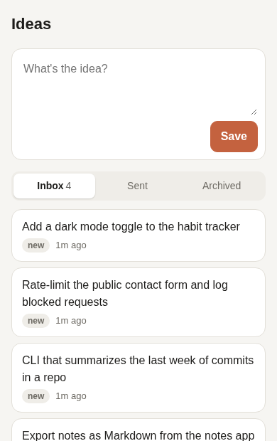
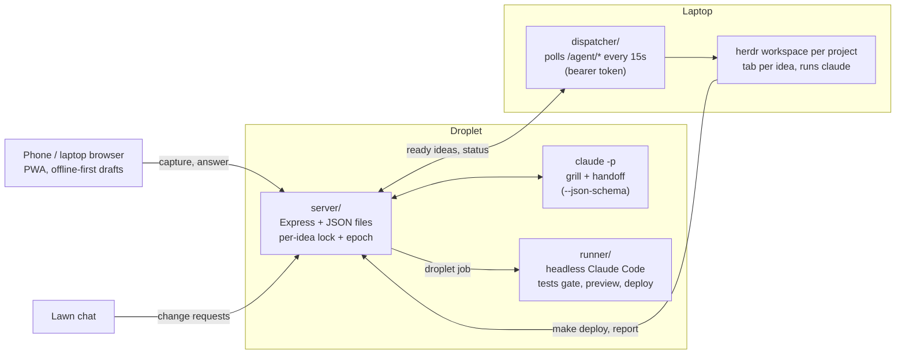

# Multi-Agent-Harness

Phone idea → Claude grills it → handoff brief → a Claude Code agent builds it in the right project, in its own herdr tab on my laptop.



## Why this exists

I used to fire off prompt after prompt and sit waiting on each one. The agent kept
hitting questions only I could answer, so it kept stopping. Now the thinking happens
first: Claude interviews me about the idea until every decision an agent would need
is settled (scope, "done", constraints, which project), then writes one complete
brief. The dispatched agent can't ask me anything, so the brief has to be enough.
I review every build later in herdr.

I direct Claude Code agents; Claude Code wrote this code. What I own is the
workflow design and the review.

## Architecture



## How it works

1. **Capture.** A mobile-first PWA (plain HTML/JS, no build step). Drafts live in
   localStorage, so a flaky connection loses nothing.
2. **Grill.** Each idea gets its own `claude -p` session. Claude reads the synced
   CLAUDE.md of relevant projects first, then asks 1-3 pointed questions at a time.
3. **Handoff.** The same session writes `{title, project, isNew, visibility, brief}`
   as JSON. I edit and approve it.
4. **Dispatch.** The laptop dispatcher claims the idea, creates the project if
   it's new, opens a herdr workspace/tab, and starts `claude` with the brief as a
   system-prompt file. If the laptop is off, ideas wait as *queued*.
5. **Ship (optional).** The agent's last step is `make deploy`: tests gate it,
   then pm2 restart with a health check and automatic rollback.
6. **Droplet alternative.** The same brief can go to `runner/`, which runs Claude
   Code headless in a sandboxed git worktree and offers preview, ship or discard.

## Design decisions

- **Bearer-token auth on `/agent/*`.** The web app sits behind a Google login at
  the proxy; the laptop can't do that login, so `/agent/*` bypasses it and the
  server checks a shared `AGENT_TOKEN` itself.
- **Per-idea locks.** One Claude call at a time per idea, so a double-tap or a
  second device can't interleave two turns in the same session.
- **Epoch cancellation.** Cancelling a grill bumps the idea's epoch and kills
  the running `claude -p`. A late result from the stale process sees the epoch
  changed and is dropped instead of overwriting fresh state.
- **Structured output via `--json-schema`.** Grilling turns come back as
  `{comment, questions[], done}`, so the UI renders tappable options. A turn
  that fails to parse falls back to plain text.
- **Briefs are files, not argv.** herdr can't pass multi-line arguments and
  pasting a long brief leaves it unsent, so the brief is passed with
  `--append-system-prompt-file` and the kickoff is one line.
- **Read-only grilling.** The griller only gets `Read,Glob,Grep`, and project
  notes are stored as `.md` copies so Claude doesn't load them as instructions.
- **Droplet runner is jailed.** bubblewrap sandbox, secret paths hidden, tests
  gate every deploy, network only for package installs.

## Status and limits

- Works end to end for me: capture, grill, handoff, laptop dispatch, droplet jobs.
- **The laptop must be on** for laptop dispatch. Ideas queue until it is.
- Not done: notifying my OpenClaw agent when a build finishes.
- Lawn's workout-tracker integration is broken (reports `configured: false`,
  zero events). Lawn is only wired in here as a chat that files change requests.
- Verification: each app has tests (`node --test`); agents are told to run them
  before committing. There is no broader QA than that.
- Single-user. There are no accounts; the proxy login is the access control.

## Tests

```
(cd server && npm ci && node --test tests/)   # API, store, jobs
node --test tests/                            # grill prompt logic
(cd runner && node --test tests/)             # runner end to end with a fake claude
```

CI runs these on every push (`.github/workflows/test.yml`).

## Using it

### 1. Capture
Open the app and type the idea into the box at the top, then hit **Save**
(or Ctrl/⌘+Enter). It can be one rough line. It lands in **Inbox**. Add the
app to your phone's home screen and it opens like a regular app.

### 2. Get grilled
Open the idea and tap **Grill me**. You can add extra context first in the
box above the button.

Claude asks 1–3 pointed questions at a time: what "done" looks like, scope,
constraints, and which project it belongs in. Before asking, it reads the
CLAUDE.md (or README) of any project the idea touches, so it doesn't ask
things your notes already answer.

- Answer in the box at the bottom and tap **Send**.
- Replies take about 5–20 seconds. You can leave the page; the answer will
  be there when you come back.
- Unsent answers are saved as drafts on that device.
- Tap the idea text at the top any time to edit it.

When Claude has enough, it says so.

### 3. Write the handoff
Tap **Write handoff**. Claude turns the whole conversation into:

- **Title**: becomes the herdr tab name.
- **Project**: one of the folders in your `PROJECTS_DIR`, or **New project…** to
  create a folder.
- **Brief**: full instructions for the agent, in Markdown.

Everything is editable. If it's off, keep answering in the chat and tap
**Rewrite handoff**.

### 4. Send it
Tap **Send to Claude Code**. The idea moves to **Sent** as *queued*. Within
about 15 seconds of your laptop being on, it shows **Running in herdr** with
the workspace, tab and agent name.

On the laptop, open herdr (`herdr`). The project has a workspace, and the idea
has its own tab with Claude already working on the brief. A herdr
notification pops up when it launches. From there it's a normal Claude Code
session: watch it, answer its questions, approve its actions.

> **New or untrusted folders:** the first time Claude opens a folder, it asks
> "Do you trust this folder?". Answer it in the herdr tab and the task
> starts. This prompt is kept on purpose as a safety check.

### Or send it to the droplet

Next to **Send to Claude Code**, choose **Where: Droplet** and **Then: Preview first** or **Go live** (existing projects only). Claude Code runs headless on the droplet, the project's tests must pass, and then you get a preview behind your Google login or a live deploy with automatic rollback. The idea's page shows the job with **Ship it live**, **Discard** and **Roll back**. Lawn's chat files the same kind of job. Setup is in Lawn's `deploy/CHAT_BUILDER.md`; how it works is in `CLAUDE.md`.

### Statuses

| Status | Meaning |
|---|---|
| **new** | Captured, not grilled yet |
| **grilling** | Conversation in progress |
| **handoff ready** | Brief written, waiting for you to send it |
| **queued** | Sent, waiting for the laptop. **Pull back** to edit it again |
| **launching** | The laptop is opening the herdr tab |
| **running** | Launched in herdr |
| **failed** | Launch failed. The reason is shown. Edit and send again |
| **archived** | Hidden from Inbox. Unarchive or delete it from the Archived tab |

### What if my laptop is off?

Nothing is lost. Sent ideas wait on the server as *queued*. The dispatcher
starts when you log in to your laptop, and within about 15 seconds it
launches everything that piled up, each in its own tab. It also starts herdr
in the background if it isn't running, so the tabs are there when you open
herdr.

### Giving the griller better context

The laptop uploads each project's `CLAUDE.md` (or `README.md` if there's no
CLAUDE.md) to the server when the dispatcher starts and every 10 minutes
after. Projects with neither file are known only by folder name, so a short
CLAUDE.md makes the grilling much sharper. To push an edit right away:

```
systemctl --user restart idea-dispatcher
```

## Setup

Everything is configured from one file, `.env`, at the repo root. You fill
it in on your laptop. `deploy.sh` copies the server's share of it to your
server, and the dispatcher reads it directly. Nothing is hardcoded to a
particular host, user, port or folder.

You need:

- **A server** you can SSH into, with Node 20+, pm2, rsync, and the `claude`
  CLI logged in as the user that will run the app. `claude` runs the
  grilling, so it uses that account's Claude subscription.
- **A reverse proxy with a login in front of it.** The app has no user
  accounts of its own. Anyone who can reach the web app can launch agents on
  your laptop, so it must not be public without a login. The example below
  uses Caddy with oauth2-proxy (Google login).
- **On the laptop:** Node 20+, [herdr](https://herdr.dev) and `claude`, plus a
  systemd user session (Linux).

### 1. Fill in `.env`
```
cp .env.example .env
openssl rand -hex 32        # paste the output in as AGENT_TOKEN
```

| Setting | Used by | |
|---|---|---|
| `DROPLET` | deploy | SSH target, e.g. `root@203.0.113.7` |
| `DROPLET_KEY` | deploy | SSH private key for it |
| `APP_USER` | deploy | Server user the app runs as. It needs pm2 and a logged-in `claude` |
| `APP_DIR` | deploy | Where the app lives on the server |
| `PM2_NAME` | deploy | pm2 process name (default `idea-pipeline`) |
| `APP_DOMAIN` | server, dispatcher | Public hostname of the web app. The dispatcher connects to `https://APP_DOMAIN` |
| `PORT` | server | Port the app binds on `127.0.0.1` (default `3006`). Point your proxy at it |
| `AGENT_TOKEN` | server, dispatcher | Shared secret that lets the laptop talk to the server |
| `GRILL_MODEL` | server | Optional model for grilling, e.g. `opus` |
| `PROJECTS_DIR` | dispatcher | Laptop folder holding your projects. New projects are created here |
| `POLL_SECONDS` | dispatcher | How often to check for sent ideas (default `15`) |
| `CLAUDE_ARGS` | dispatcher | Extra flags for each launched `claude`, e.g. `"--permission-mode plan"` |
| `REMOTE_CONTROL` | dispatcher | `1` (default) starts each agent with Remote Control so you can follow and steer it from the Claude app; `0` turns it off |
| `HERDR_SESSION` | dispatcher | Named herdr session to launch into (blank = the default session) |

`.env` is gitignored, so your hosts, paths and token stay out of the repo.
Quote any value that contains spaces.

### 2. Deploy the server
```
./deploy.sh
```
This:
1. Copies `server/` to `APP_DIR`.
2. Writes the server's settings (`PORT`, `AGENT_TOKEN`, `GRILL_MODEL`) to
   `APP_DIR/config.env`.
3. Installs dependencies and (re)starts the app under pm2 as `APP_USER`.

Re-run it after any change to `server/` or to those settings. It never
touches the server's `data/` (your ideas). For server-only extras such as
`CLAUDE_CODE_OAUTH_TOKEN` or `CLAUDE_BIN`, put them in a hand-made
`APP_DIR/.env`; deploys leave that file alone.

### 3. Put it on the web
Point a DNS record for `APP_DOMAIN` at the server. Then route it through your
proxy:

- `/agent/*` is for the laptop, so it **skips** the login. The app checks
  `AGENT_TOKEN` itself.
- Everything else **requires** the login.

With Caddy and oauth2-proxy (replace the domain and port with yours):

```
ideas.example.com {
	handle /agent/* {
		reverse_proxy localhost:3006
	}
	handle {
		forward_auth localhost:4180 {
			uri /oauth2/auth
			# on 401, redirect to your oauth2-proxy sign-in page
		}
		reverse_proxy localhost:3006
	}
}
```
```
caddy validate --config /etc/caddy/Caddyfile && systemctl reload caddy
```

### 4. Install the laptop dispatcher
```
dispatcher/install.sh
```
This checks `.env`, then installs and starts a systemd user service that runs
at every login. It reads `.env` from this repo folder, so if you move the
repo, run `install.sh` again. After editing the dispatcher settings in
`.env`, restart it.

```
journalctl --user -u idea-dispatcher -f     # watch it
systemctl --user restart idea-dispatcher    # restart it
```

## Troubleshooting

- **"Signed out — tap to sign in again"**: your login session expired.
  Tap the banner.
- **Stuck on *queued***: the laptop isn't picking it up. Check
  `journalctl --user -u idea-dispatcher -f`. `Unauthorized` means
  `AGENT_TOKEN` differs between laptop and server (re-run `./deploy.sh`).
  Otherwise the server isn't reachable at `https://APP_DOMAIN/agent/`.
- **Grilling errors**: `claude` on the server isn't logged in, or isn't on
  `APP_USER`'s PATH. Check the logs with `pm2 logs <PM2_NAME>`, run as
  `APP_USER`.
- **"Invalid API key · Fix external API key"**: an `ANTHROPIC_API_KEY` is
  set for the app (for example in the server's hand-made `.env`), and Claude
  uses it instead of the login. Remove it, then restart the app *as
  `APP_USER`*. Root has its own separate pm2, so `pm2 restart` run as root
  doesn't touch the app.
- **Tab opened but Claude is idle**: it's probably waiting at the "trust this
  folder?" prompt. Answer it in herdr.

Implementation notes for working on the code are in [CLAUDE.md](CLAUDE.md).
